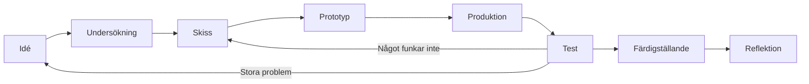

# Kapitel 1: Skapandeprocessen

> **I det här kapitlet lär du dig**
> - vilka faser ett skapande arbete brukar gå igenom
> - hur analoga och digitala arbetssätt kan växla och stärka varandra
> - varför tekniken påverkar vad som går att uttrycka
> - hur du dokumenterar ett arbete så att det går att följa i efterhand

Tänk på det senaste spelet du fastnade i. Någon bestämde hur himlen skulle se ut, vilket ljud det skulle låta när du tog ett mynt och hur länge du skulle få vänta innan något hände. Inget av det kom till av en slump. Bakom varje färdigt digitalt verk finns en lång rad val, och många av dem gjordes om flera gånger.

I den här kursen ska du göra två spel. Men du är inte här bara för att få koden att fungera. Du är här för att skapa något som en annan människa upplever. Det kräver att du kan arbeta i en process, och det är där boken börjar.

## Vad en skapandeprocess är

En **skapandeprocess** är vägen från en första tanke till ett färdigt verk. Vägen ser olika ut för olika personer och verk, men de flesta processer innehåller ungefär samma faser.

| Fas | Vad du gör | Exempel i ett spel |
|---|---|---|
| Idé | Samlar tankar, frågar "tänk om ..." | "Tänk om du bara ser det lampan lyser upp" |
| Undersökning | Tittar på andra verk, samlar referenser | Spelar två spel med mörker, sparar bilder på fyrar |
| Skiss | Provar snabbt och billigt | Ritar banor på papper |
| Prototyp | Bygger den enklaste versionen som går att prova | Grå rutor som rör sig i Godot |
| Produktion | Gör det riktiga materialet | Ritar figurer, spelar in ljud |
| Test och omarbetning | Låter andra prova, ändrar | Testspelaren hittar inte oljan, du flyttar den |
| Färdigställande | Putsar, exporterar | Menyer, ljudnivåer, körbar fil |
| Reflektion | Värderar vad som blev bra och varför | Skriver vad du skulle gjort annorlunda |

Tabellen ser ut som en trappa, men en verklig process är mer som en spiral. Du kommer ofta tillbaka till en tidigare fas med nya kunskaper.



Att gå tillbaka är inte ett misslyckande. Det kallas att arbeta **iterativt**: du gör något, provar det, lär dig och gör en bättre version. Det som däremot kostar mycket är att upptäcka ett stort fel sent. En bana som ändras på papper tar en minut. Samma ändring när grafik, ljud och kod är klara kan ta en hel lektion.

## Analogt och digitalt

**Analogt** arbete sker med fysiska material: penna, papper, lera, ett riktigt instrument. **Digitalt** arbete sker med data i en dator, där allt till slut lagras som tal.

Det är lätt att tro att digitalt är nästa steg och analogt något man lämnar bakom sig. I praktiken väljer erfarna skapare det som passar för stunden.

| | Analogt | Digitalt |
|---|---|---|
| Styrka | Snabbt, inga menyer, lätt att tänka fritt | Lätt att ändra, kopiera, ångra och dela |
| Svaghet | Svårt att ångra och skicka vidare | Verktyget kan styra och stjäla fokus |
| Passar för | Tidiga idéer, flera varianter, gruppdiskussion | Precision, produktion, slutresultat |

Det intressanta sker i **övergångarna**, där arbetet byter form:

- Du ritar en figur på papper, fotograferar den och ritar rent i ett digitalt lager ovanpå.
- Du knackar på ett glas, spelar in det med mobilen och bearbetar ljudet i dator.
- Du bygger en bana av pappersbitar och flyttar runt dem tills den känns rätt. Sedan bygger du den i Godot.
- Du skriver ut en skärmbild och ritar över den med rödpenna för att se vad som ska ändras.

Varje övergång förändrar något. Ett fotograferat streck blir ojämnt på ett sätt som inte går att få fram med ett digitalt verktyg. Det kan vara precis det som ger ditt spel personlighet.

## Gränslandet mellan konst och teknik

Digitalt skapande befinner sig mellan två världar. Från konsten kommer frågor som "vad vill jag säga?" och "vilken känsla ska det här väcka?". Från tekniken kommer frågor som "vad klarar datorn?" och "hur lagras det här?". Den ena sortens frågor kan inte besvaras utan den andra.

Teknikens gränser har ofta format hela uttryckssätt. Den handhållna konsolen Game Boy hade en skärm på 160 gånger 144 bildpunkter och kunde bara visa fyra gråtoner. Tecknarna var tvungna att göra figurer som gick att känna igen med väldigt få punkter. I dag kan datorer visa nästan vad som helst, men många väljer ändå medvetet en grov pixelstil. Det som en gång var en begränsning har blivit en estetik, ett konstnärligt uttryck i sig.

Du kan använda samma tanke i dina egna spel. Om du inte hinner rita detaljerade figurer kan du göra allt i tre färger och en enkel form. Begränsningen blir då ett stilval i stället för en brist. Kapitel 6 visar hur.

Verktyg är inte heller neutrala. Ett program föreslår vissa lösningar genom sina standardinställningar och mallar. Om alla använder samma mallar blir alla spel lika. Ha därför ett **kritiskt förhållningssätt**: fråga varför ett verktyg gör som det gör, och om det passar det du vill uttrycka.

## Att dokumentera processen

**Dokumentation** är det du sparar för att visa hur arbetet gick till. Det är inte samma sak som det färdiga spelet. En bra dokumentation besvarar tre frågor: vad gjorde jag, varför gjorde jag så, och vad lärde jag mig?

Det enklaste sättet är en **processlogg**, en anteckning efter varje arbetspass.

### Genomgånget exempel: en loggpost

Genom hela boken använder vi ett påhittat exempelspel, **Fyrvaktaren**. Du är fyrvaktare på en ö en stormig natt. Lamporna längs stranden brinner ner, och du måste hämta olja och fylla på dem innan gryningen kommer. Så här kan en loggpost se ut efter ett arbetspass:

```text
Lektion 7, grafik
Gjorde:     Ritade spelaren i två varianter, lagt in båda i spelet.
Beslut:     Valde den mörka silhuetten med ljus lykta.
Varför:     Den ljusa figuren försvann mot den ljusa stranden i test.
Problem:    Lyktan flimrar vid animationen, ska kolla bildrutorna.
Nästa pass: Rita om lyktans tre rutor, börja på strandens tiles.
Bild:       logg/lektion7-silhuett.png
```

Lägg märke till raden "Varför". Det är där du visar att du gjort ett medvetet val, och det är ofta den raden som skiljer en enkel dokumentation från en noggrann. Spara också bilder av det som inte blev bra. Två skisser som visar hur figuren utvecklades säger mer än en färdig bild.

## Begrepp

- **Skapandeprocess:** vägen från idé till färdigt verk, indelad i faser.
- **Iteration:** att göra, prova, lära och göra om i en bättre version.
- **Prototyp:** en enkel version gjord för att prova en idé.
- **Analogt arbete:** skapande med fysiska material och verktyg.
- **Digitalt arbete:** skapande där materialet lagras och bearbetas som data.
- **Estetik:** de konstnärliga och känslomässiga egenskaperna hos ett verk, till exempel stil och stämning.
- **Dokumentation:** det material som visar hur och varför ett arbete blev som det blev.

## Testa dig själv

1. Nämn de faser som ingår i en skapandeprocess och beskriv kort vad som händer i två av dem.
2. Varför kan det bli billigare att gå tillbaka till skissen tidigt än att ändra sent?
3. Ge ett exempel på en övergång från analogt till digitalt och en från digitalt till analogt.
4. Vad menas med att en teknisk begränsning kan bli en estetik?
5. Varför är det inte säkert att ett verktygs standardinställningar är bra för ditt verk?
6. Vilka tre frågor ska en bra dokumentation besvara?

## Övningar

**Grund.** Välj ett spel eller en film du tycker om. Skriv ner tre saker du tror att skaparna ändrade under arbetet, och motivera varför de kan ha gjort det.

**Grund.** Skriv en loggpost efter nästa lektion, med samma rader som i exemplet.

**Vidare.** Rita samma figur på två sätt: först för hand, sedan i ett digitalt ritprogram. Lägg bilderna bredvid varandra. Beskriv vad som blev annorlunda och vilken som passar bäst för ett spel.

**Utmaning.** Hitta ett digitalt verk, till exempel ett spel, en app eller en digital konstinstallation, där teknikens begränsningar syns tydligt. Skriv ett kort stycke om hur begränsningen påverkar upplevelsen.

## Koppling till projektet

I [2D-spelet](../projekt/2d-spel/README.md) och [3D-spelet](../projekt/3d-spel/README.md) går du igenom hela processen två gånger. Starta din processlogg redan första lektionen. Betygskriterierna handlar om hur väl du känner till processens faser och om hur noggrann din dokumentation är, så loggen är en viktig del av underlaget.

## Läs mer

- [Godots dokumentation](https://docs.godotengine.org/en/stable/getting_started/first_2d_game/index.html), startsidan för det första 2D-spelet.
- [Kursplan och täckningsmatris](../kursplan.md)

[Innehåll](../README.md) | [Nästa →](02-spelide-och-berattande.md)
