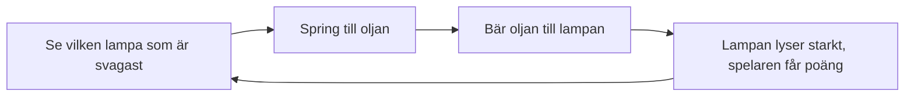

# Kapitel 2: Spelidé och berättande

> **I det här kapitlet lär du dig**
> - hur du går från en vag tanke till en tydlig spelidé
> - vad spelmekanik är och hur den skapar känslor
> - hur ett spel kan berätta utan långa texter
> - hur du tänker på vem som ska spela

Många spel börjar med "det ska vara som mitt favoritspel, men större". Det brukar sluta med att spelet aldrig blir klart. En bra spelidé är nästan alltid mindre än man tror. Den går att säga i en mening, och den väcker nyfikenhet hos den som hör den.

## Från tanke till spelidé

En idé blir användbar först när den går att beskriva kort. En enkel mall för en **pitch**, en mycket kort beskrivning av idén, ser ut så här:

> Du är **[vem]** som måste **[mål]** genom att **[vad du gör]**, medan **[motstånd]**.

Prova med vårt exempelspel:

> Du är en fyrvaktare som måste hålla öns lampor tända till gryningen genom att bära olja mellan dem, medan stormen släcker dem en efter en.

Meningen säger vem du är, vad som står på spel och vad du faktiskt gör med händerna. Den sista delen är viktigast. Om du inte kan säga vad spelaren gör sekund för sekund har du inte en spelidé, bara en stämning.

### Fem sätt att få idéer

- **Kombinera:** ta två saker som inte brukar höra ihop, till exempel "matlagning" och "rymden".
- **Vänd på något:** i stället för att jaga blir du jagad, i stället för att bygga river du.
- **Börja med en känsla:** vilken känsla vill du väcka? Stress, lugn, skam, nyfikenhet?
- **Börja med en begränsning:** spelet har bara en knapp, eller en enda skärm.
- **Utgå från något du vet:** din hobby, din hemstad, ditt jobb.

Du får också återskapa ett känt spel. Det är en bra övning, men även då kan du göra något eget, till exempel byta miljö eller lägga till en regel. Kapitel 5 tar upp vad du får och inte får kopiera från ett känt spel.

## Mekanik, dynamik och upplevelse

**Spelmekanik** är reglerna och handlingarna i ett spel: hoppa, samla, skjuta, ta slut på tid. Mekaniken säger dock inget om hur spelet känns. En användbar modell kommer från forskarna Hunicke, LeBlanc och Zubek, som delar upp ett spel i tre nivåer, ofta kallad MDA (Mechanics, Dynamics, Aesthetics):

| Nivå | Betyder | Fyrvaktaren |
|---|---|---|
| Mekanik | Reglerna du bestämmer | Lampor tappar olja med tiden. Du kan bära en kanna. |
| Dynamik | Det som händer när reglerna körs | Spelaren börjar springa i slingor, måste välja vilken lampa som offras |
| Upplevelse | Det spelaren känner | Stress, ansvar, lättnad när gryningen kommer |

Du som skapare börjar i mekaniken. Spelaren börjar i upplevelsen. Därför är det klokt att bestämma den önskade känslan först och sedan fråga vilka regler som kan skapa den. Vill du väcka ensamhet fungerar kanske inte tio fiender och högt tempo.

### Spelets kärna

Nästan varje spel har en **kärnloop**, en kort följd av handlingar som spelaren upprepar om och om igen.

Kärnloopen är det första du ska prova i en prototyp. Är den tråkig med grå rutor räddar ingen grafik spelet. Är den rolig med grå rutor har du något att bygga vidare på.

## Berättande i spel

Du behöver inte skriva långa texter för att berätta något. Spel har egna berättarverktyg, och de fungerar ofta bäst när de används tillsammans.

| Verktyg | Så fungerar det | Exempel |
|---|---|---|
| Berättelse i ord | Text, röst, dialog | Ett kort brev från den förra fyrvaktaren på startskärmen |
| Miljöberättande | Platsen berättar vad som hänt | En rad släckta lampor och en krossad båt på stranden |
| Berättande genom mekanik | Reglerna säger något | Lamporna brinner ner snabbare ju längre natten går, stormen blir värre |
| Berättande genom ljud | Ljudet bär stämningen | Stormen dämpas när gryningen närmar sig |

**Miljöberättande** betyder att spelaren själv får lista ut vad som hänt genom det som syns. Det är kraftfullt eftersom hjärnan fyller i luckorna, och det kostar nästan ingen text.

Den klassiska berättelsen har en början, en mitt och ett slut. I ett litet spel kan det vara hur spelet börjar lugnt, blir svårare och når en höjdpunkt:

1. **Början:** en lampa, svag vind, spelaren lär sig bära olja.
2. **Mitt:** fler lampor, stormen tilltar, svårare val.
3. **Slut:** de sista minuterna före gryningen, sedan ljus och stillhet.

Att spelet stegras på det här sättet kallas **dramaturgi**. Det handlar om hur spänning byggs upp och släpper över tid, precis som i film.

Ett vanligt fel är att spelet säger en sak och reglerna en annan. Om berättelsen handlar om att rädda människor men poängen kommer av att skjuta dem känner spelaren av att något skaver. Fråga dig: stämmer det jag berättar med det spelaren faktiskt gör?

## Målgrupp och syfte

Vem ska spela? En **målgrupp** är den grupp människor du gör verket för. Den behöver inte vara stor. "Klasskamrater som aldrig spelat plattformsspel" är en bättre målgrupp än "alla".

Fråga dig:

- Har målgruppen spelat något liknande förut?
- Hur länge vill de spela vid ett tillfälle?
- Vilket språk förstår de?
- Finns det innehåll som inte passar deras ålder? PEGI:s [åldersmärkning](https://www.pegi.info/what-do-the-labels-mean) visar hur våld, språk och skräck vägs in.

### Genomgånget exempel: från tanke till spelidé

Ett spel kan växa fram så här, i fem steg.

1. **Tanke:** "Jag gillar havet och stormar."
2. **Känsla:** "Jag vill att spelaren ska känna ansvar och lite stress."
3. **Handling:** "Spelaren ska ta hand om något som hela tiden håller på att gå sönder." Lampor verkar enkelt.
4. **Pitch:** meningen ovan.
5. **Test på papper:** Rita fem lampor, sätt ett mynt på varje och ta bort ett mynt var femte sekund. Flytta ett lock runt bordet som är din fyrvaktare. Går det att hinna? Blir det spännande? Efter fem minuter vet du om idén bär.

Det sista steget är analogt och tar en stund. Det är så du märker om spelet har en fungerande kärnloop innan du öppnar Godot.

## Begrepp

- **Pitch:** en mycket kort beskrivning av en idé.
- **Spelmekanik:** reglerna och handlingarna i ett spel.
- **Dynamik:** det beteende som uppstår när spelet körs.
- **Kärnloop:** den korta följd av handlingar som spelaren upprepar.
- **Miljöberättande:** att berätta genom hur platsen ser ut och vad som finns där.
- **Dramaturgi:** hur spänning byggs upp och släpper över tid.
- **Målgrupp:** de människor verket är gjort för.

## Testa dig själv

1. Vad måste en pitch säga för att spelidén ska vara tydlig?
2. Vad är skillnaden mellan mekanik och upplevelse? Ge ett exempel.
3. Varför bör du testa kärnloopen med enkel grafik först?
4. Beskriv hur en plats i ett spel kan berätta något utan text.
5. Vad menas med att berättelse och regler kan säga olika saker?
6. Varför är en smal målgrupp oftast bättre än "alla"?

## Övningar

**Grund.** Skriv tre pitchar med mallen. En ska vara inspirerad av något du gillar, en ska börja med en känsla och en ska börja med en begränsning.

**Grund.** Välj ett spel du känner till. Rita spelets kärnloop som fyra rutor med pilar.

**Vidare.** Gör en pappersprototyp av en av dina pitchar. Testa den med någon i fem minuter och skriv ner vad som hände. Var det som du hade tänkt?

**Utmaning.** Analysera ett kort spel utifrån de tre nivåerna: mekanik, dynamik och upplevelse. Hitta ett tillfälle där mekaniken och berättelsen stärker varandra, och ett där de krockar.

## Koppling till projektet

I [2D-spelets](../projekt/2d-spel/README.md) planeringslektion ska du beskriva din spelidé. Använd pitchmallen som första mening i planen, och ha en tydlig kärnloop klar innan du börjar bygga. I [3D-spelet](../projekt/3d-spel/README.md) kräver projektplanen dessutom att du skriver ut en målgrupp.

## Läs mer

- [MDA-modellen, forskarnas originaltext (PDF)](https://users.cs.northwestern.edu/~hunicke/MDA.pdf)
- [PEGI: vad åldersmärkningarna betyder](https://www.pegi.info/what-do-the-labels-mean)

[← Föregående](01-skapandeprocessen.md) | [Innehåll](../README.md) | [Nästa →](03-skiss-och-plan.md)
