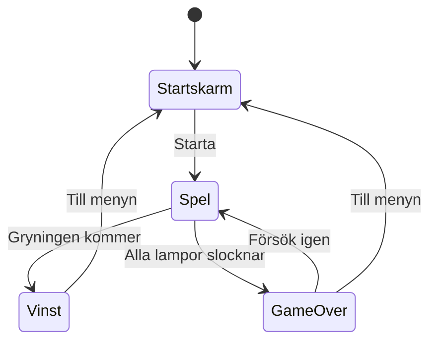

# Kapitel 3: Skissa och planera

> **I det här kapitlet lär du dig**
> - att skissa snabbt med både penna och dator
> - att göra en moodboard och en pappersprototyp
> - att skriva en projektplan som faktiskt går att följa
> - att uppskatta tid och skära bort det du inte hinner

Den vanligaste orsaken till att ett skolspel inte blir klart är inte att koden är svår. Det är att planen var för stor. I det här kapitlet lär du dig att tänka på papper innan du bygger och att bestämma redan från början vad som får strykas.

## Varför skissa?

En **skiss** är ett snabbt försök som inte behöver bli vackert. Den är till för att du ska förstå en idé, och för att andra ska kunna förstå den. Att skissa är att tänka med handen. Du kommer på saker medan du ritar, som du aldrig hade kommit på i huvudet.

Skissarbetet har några vanliga former:

| Skiss | Vad den visar | Bra verktyg |
|---|---|---|
| Miniatyrer | Många små varianter av en figur eller bana | Penna och papper |
| Banskiss | Hur en nivå är uppbyggd sedd ovanifrån eller från sidan | Rutat papper |
| Skärmskiss | Vad som syns på skärmen och var | Penna, Excalidraw, Figma |
| Storyboard | Vad som händer i en följd av bilder | Penna, digitalt ritprogram |
| Färgskiss | Vilka färger och stämningar som ska gälla | Krita, GIMP |

Börja på papper för att få fram mängd och variation. Regeln "rita tio små i stället för en stor" tvingar fram idéer du inte hade tänkt på. Gå sedan över till digitalt när du vet vad du vill och vill kunna ändra, skala och dela.

### Moodboard

En **moodboard** är en sida med bilder, färger och texturer som fångar stämningen du söker. För Fyrvaktaren kan den vara fotografier av fyrar i dimma, en palett med mörkblått och gult ljus och en bild på gammalt sjökort. Moodboarden är ett arbetsredskap, du ska inte använda bilderna i spelet. Skriv vad du samlat in och varifrån, så är du förberedd på resonemanget i kapitel 5.

### Pappersprototyp

En **pappersprototyp** är en version av spelet gjord av papper, mynt och spelkort. Den låter dig testa reglerna utan en rad kod. Kapitel 2 visade hur Fyrvaktaren kunde testas med mynt på ett bord.

Skärmar och menyer kan också prövas på papper. Rita varje skärm på ett papper, och låt testaren "klicka" med fingret. Du byter papper när något händer. Det avslöjar om knappen "Starta" faktiskt går att hitta.

## Skisser av spelets flöde

Det hjälper att rita hur spelets **skärmar** hänger ihop, alltså vad som leder vidare till vad. Det kan du göra som ett flödesschema eller ett tillståndsdiagram.



För spelets logik kan du skriva **pseudokod**, en beskrivning av logiken med vanliga ord i stället för riktig kod. Du behöver inte kunna programmera för att skriva den:

```text
Varje sekund:
    minska oljan i alla lampor
    om en lampa är tom: släck den

Om spelaren är vid oljedepån och trycker på E:
    fyll kannan

Om spelaren är vid en lampa och har olja och trycker på E:
    fyll lampan, töm kannan

Om alla lampor är släckta: gå till Game Over
Om tiden är slut:          gå till Vinst
```

Pseudokoden är en del av planen, men den går också att visa som ett diagram. Använd det som hjälper dig. I kursen Programmering går man igenom detta i detalj. Här räcker det att spelets regler står så tydligt att någon annan kan läsa och förstå dem.

## Projektplanen

En **projektplan** är det dokument som håller ihop ditt arbete. Den ska vara kort och levande, alltså något du faktiskt läser och ändrar. En bra plan för ett spel innehåller:

- **Spelidé:** din pitch.
- **Målgrupp:** vem spelet är för.
- **Skisser:** banor, skärmar, figurer.
- **Stil:** tre ord och din moodboard.
- **Kravlista:** det spelet måste ha, och det som vore kul att ha.
- **Tekniska förutsättningar:** vilken version av Godot, vilka program, vilken dator spelet ska gå på.
- **Tidsplan:** vad som ska vara klart och när.

### Kravlista och prioritering

**Omfång**, på engelska scope, betyder hur mycket du försöker göra. Den vanligaste fällan är att göra det för stort. Dela därför kravlistan i tre delar:

| Prioritet | Betydelse | Exempel i Fyrvaktaren |
|---|---|---|
| Måste | Spelet fungerar inte utan det | Bära olja, lampor slocknar, vinst och förlust |
| Bör | Gör spelet tydligt mycket bättre | Vind som puttar spelaren, stormljud |
| Kan | Om tid finns | En andra ö, nattens höjdpunkt |

Börja alltid med det som står under Måste. Bygg en version som går att spela från början till slut så tidigt du kan, och fyll sedan på.

### Genomräknat exempel: tidsuppskattning

Säg att du har 25 arbetstimmar att fördela. Skriv upp uppskattade timmar för varje del. Var ärlig, och kom ihåg att saker tar längre tid än du tror.

| Del | Timmar |
|---|---:|
| Planering och skisser | 2 |
| Grundmekanik | 3 |
| Grafik | 4 |
| Gränssnitt och menyer | 3 |
| Fiender och samlarföremål | 2 |
| Ljud och musik | 2 |
| Scenbyten och omstart | 1 |
| Testning | 3 |
| Finslipning | 1,5 |
| Export och redovisning | 1,5 |
| Reservtid | 1 |
| Dokumentation | 1 |
| **Summa** | **25** |

Reservtiden är 1 av 25 timmar, alltså 4 procent. Det är ganska lite, så om något går fel måste du stryka något från Bör eller Kan. Väljer du i stället att lägga 20 procent av tiden som reserv motsvarar det 5 av 25 timmar. Då krymper planen, men den håller bättre när något oväntat händer.

Prioriteringen avgör vad som stryks: Kan först, sedan Bör, aldrig Måste. När något stryks skriver du det i loggen med motivering. Det är precis den sortens medvetet val som bedömningen letar efter.

### Att värdera sin plan

En plan är en gissning. Under arbetets gång ser du om den stämmer. Efter projektet jämför du: vad planerade du, vad blev det och varför skilde det sig? Det kallas att **värdera** planen, och det är en del av 3D-projektets bedömning.

## Begrepp

- **Skiss:** ett snabbt försök som hjälper dig att tänka.
- **Moodboard:** en samling bilder och färger som visar den stämning du vill nå.
- **Storyboard:** en följd av bilder som visar vad som händer över tid.
- **Pappersprototyp:** en version av spelet gjord i papper för att prova regler och skärmar.
- **Pseudokod:** logik beskriven med vanliga ord.
- **Omfång:** hur mycket som ingår i ett projekt.
- **Prioritering:** att bestämma vad som är viktigast och vad som kan strykas.

## Testa dig själv

1. Varför lönar det sig att rita tio små skisser i stället för en stor?
2. Vad är skillnaden mellan en moodboard och en skärmskiss?
3. När i processen är en pappersprototyp mest användbar?
4. Vad behöver finnas med i en projektplan?
5. Vad betyder "Måste, Bör, Kan", och varför är det användbart?
6. Varför bör du ha en spelbar version så tidigt som möjligt?
7. Vad innebär det att värdera en projektplan efter ett projekt?

## Övningar

**Grund.** Gör tio miniatyrer av en spelfigur på ett papper. Ge dig själv högst tjugo sekunder per figur. Ringa in de två bästa och skriv varför.

**Grund.** Rita ett tillståndsdiagram över alla skärmar i ett spel du känner till.

**Vidare.** Du har 20 timmar och vill lägga 15 procent som reservtid. Hur många timmar är kvar att fördela? Fördela dem på minst sex delar.

<details><summary>Svar</summary>

15 procent av 20 timmar är 3 timmar. Det är 20 − 3 = 17 timmar kvar att fördela.

</details>

**Vidare.** Gör en pappersprototyp av en menyskärm och låt en kompis försöka starta spelet och ändra ljudvolymen. Skriv upp var kompisen tvekade.

**Utmaning.** Skriv hela projektplanen för ett litet spel med alla punkter ovan. Låt någon annan läsa den och berätta för dig vad spelet går ut på. Stämmer det med din bild?

## Koppling till projektet

Planeringen är en egen del av båda projekten. I [2D-spelet](../projekt/2d-spel/README.md) ska du skriva ett dokument med spelidé, skiss och pseudokod eller flödesschema och få det godkänt. I [3D-spelet](../projekt/3d-spel/README.md) krävs en projektplan med spelidé, målgrupp, skisser, kravlista och tekniska förutsättningar.

## Läs mer

- [Excalidraw](https://excalidraw.com/) för snabba digitala skisser
- [Figma](https://www.figma.com/) för skärmskisser

[← Föregående](02-spelide-och-berattande.md) | [Innehåll](../README.md) | [Nästa →](04-verktyg-och-samarbete.md)
