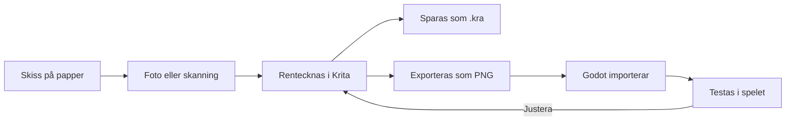

# Kapitel 4: Verktyg och samarbete

> **I det här kapitlet lär du dig**
> - vilka programvaror och vilken hårdvara som används för bild, ljud och spel
> - hur ett arbetsflöde hänger ihop från skiss till färdigt spel
> - att hålla ordning på filer och format
> - att samarbeta digitalt med delade dokument och Git

Du kommer att använda fler program i den här kursen än du kanske tror. En figur ritas i ett program, får ljud från ett annat och hamnar till slut i spelmotorn. Att kunna flytta ett arbete mellan verktyg utan att det går sönder är en färdighet i sig. Det kallas att ha ett **arbetsflöde**.

## Programvara

Du behöver inte kunna alla program. Lär dig ett i varje kategori så väl att det inte står i vägen. Tabellen visar exempel på vanliga program. De flesta är gratis, men kontrollera alltid aktuella villkor på programmets webbplats.

| Uttrycksform | Exempel på program | Används till |
|---|---|---|
| Spelmotor | [Godot](https://godotengine.org/) | Sätta ihop allt till ett spel |
| Rita och måla | [Krita](https://krita.org/en/), [GIMP](https://www.gimp.org/) | Figurer, bakgrunder, texturer |
| Pixelgrafik | [Piskel](https://www.piskelapp.com/), [Aseprite](https://www.aseprite.org/) (kostar pengar) | Små figurer och animation |
| 3D | [Blender](https://www.blender.org/) | Modeller, material, animation |
| Ljudredigering | [Audacity](https://www.audacityteam.org/) | Klippa, rensa, normalisera ljud |
| Ljudeffekter | [sfxr](https://sfxr.me/), [Bfxr](https://www.bfxr.net/) | Korta syntetiska effekter |
| Musik | [LMMS](https://lmms.io/), [MuseScore](https://musescore.org/) | Egen musik, loopar |
| Skisser | [Excalidraw](https://excalidraw.com/), [Figma](https://www.figma.com/) | Skärmskisser, diagram |

**Godot** är en spelmotor, ett program som samlar grafik, ljud, fysik och logik till ett körbart spel. Godot är fri och öppen programvara under MIT-licens. Det betyder att du får använda det för vilket syfte du vill, och spelet du skapar är ditt eget.

I Godot är allt uppbyggt av **noder**, små byggstenar med en bestämd uppgift. En `Sprite2D` visar en bild och en `AudioStreamPlayer` spelar ljud. Flera noder tillsammans bildar en **scen**. En scen kan vara en figur, en meny eller en hel bana, och scener kan läggas inuti varandra. Det är en bra bild av hur man tänker digitalt: små delar som går att återanvända och byta ut.

## Hårdvara

Hårdvara är de fysiska apparaterna. Du kan komma långt med en vanlig dator och en mobil, men det är bra att känna till vad som finns.

| Hårdvara | Användning | Att tänka på |
|---|---|---|
| Ritplatta | Digital teckning med tryckkänslig penna | Tar tid att vänja sig vid |
| Mobilkamera | Fotografera skisser, spela in referenser | Jämnt ljus ger bäst resultat |
| Mikrofon | Spela in röster och ljudeffekter | Spela in i ett tyst rum |
| Hörlurar | Lyssna på detaljer i ljudet | Testa också på vanliga högtalare |
| Handkontroll | Testa hur spelet känns | Testa att alla knappar går att nå bekvämt |

Tänk också på vad spelaren har. Ett spel som bara fungerar på en kraftig dator är inte färdigt om målgruppen använder skoldatorer.

## Filer och format

Ett **filformat** bestämmer hur informationen i en fil lagras. Olika format passar för olika saker, och valet påverkar både kvalitet och filstorlek.

| Format | Typ | Bra för |
|---|---|---|
| PNG | Bild utan kvalitetsförlust, kan vara genomskinlig | Sprites och gränssnitt |
| JPG | Bild med kvalitetsförlust, ingen genomskinlighet | Fotografier |
| SVG | Vektorbild | Ikoner, loggor |
| WAV | Ljud, stort | Korta ljudeffekter |
| OGG | Ljud, komprimerat | Musik |
| glTF/GLB | 3D-modell | Överföring från Blender till Godot |

Grafik kan vara **rastergrafik**, en matris av små färgade punkter (pixlar), eller **vektorgrafik**, former beskrivna med matematik. Rastergrafik blir suddig när den förstoras men är rätt för målade bilder. Vektorgrafik kan förstoras hur mycket som helst men passar sämre för detaljerade bilder.

Skillnaden mellan **källfil** och **exportfil** är viktig. Källfilen är din arbetsfil, med lager och ändringsmöjligheter, till exempel en `.kra` från Krita eller en `.blend` från Blender. Exportfilen är den färdiga PNG- eller glTF-filen du lägger i spelet. Spara alltid källfilerna, annars måste du börja om när något ska ändras.

### Genomräknat exempel: hur stor är en bild?

En bild utan komprimering tar plats enligt:

```text
bredd × höjd × byte per pixel
```

En bild på 1920 × 1080 pixlar i färg med genomskinlighet använder 4 byte per pixel (röd, grön, blå och genomskinlighet):

```text
1920 × 1080 × 4 = 8 294 400 byte ≈ 8,3 MB
```

PNG-filer är normalt mindre på disk tack vare komprimering, men när bilden visas behöver grafikminnet ofta hantera den okomprimerat. Ett spel med många stora bilder blir därför snabbt tungt, oavsett hur liten filen ser ut.

## Ett arbetsflöde från skiss till spel



Godot importerar filer automatiskt när du lägger dem i projektmappen. En tydlig mappstruktur sparar mycket tid:

```text
fyrvaktaren/
├── grafik/
│   ├── kalla/          (källfiler: .kra, .blend)
│   ├── spelare/        (PNG)
│   └── miljo/
├── ljud/
│   ├── effekter/
│   └── musik/
├── scener/
├── skript/
└── KREDITER.md
```

Använd små bokstäver och namn utan mellanslag, till exempel `spelare_gang.png`. Godots dokumentation rekommenderar det sättet att skriva filnamn, eftersom det undviker problem efter export: spelets interna filsystem skiljer på stora och små bokstäver, även om Windows gör det inte.

## Digital samverkan

När flera arbetar tillsammans behövs verktyg för att dela filer och prata med varandra. Det kallas **digital samverkan**, och det behöver bli en vana även när du arbetar ensam, för du samarbetar alltid med ditt framtida jag.

| Behov | Verktyg | Exempel |
|---|---|---|
| Skriva tillsammans | Delade dokument | Projektplan som alla kan redigera |
| Bestämma och fråga | Chatt | Kanal med en tråd per del av spelet |
| Skissa tillsammans | Gemensam whiteboard | Excalidraw eller Figma |
| Dela kod och filer | Versionshantering | Git och GitHub |
| Hålla koll på vad som görs | Uppgiftslista | Kolumnerna Att göra, Pågår, Klart |

Bestäm tidigt var information ska finnas. Om besluten ligger utspridda över tre chattar, ett dokument och en bild i någons mobil försvinner de. Ett bra sätt är att ha en plats för beslut, den kan vara projektplanen eller loggen.

**Versionshantering** betyder att alla ändringar sparas som en historik. **Git** är det vanligaste verktyget. **GitHub** är en webbtjänst där du kan lagra projektet och dela det. Du sparar en version med `commit` och skickar upp den med `push`. Skriv korta meddelanden som säger vad du gjort och gärna varför. Med commitmeddelandena får du en automatisk logg över arbetet.

Spelprojekt innehåller ofta stora filer. GitHub blockerar filer större än 100 MiB. **Git LFS** är ett tillägg som lagrar stora filer på ett separat sätt, och det används i 3D-projektet. Hur du ställer in det finns beskrivet i [guiden till 3D-spelet](https://github.com/abbjetmus/Godot-3D-Spel). Godots mapp `.godot/` är cache och ska inte versionshanteras. Den skapas automatiskt igen.

I en grupp behöver ni dessutom bestämma vem som ansvarar för vad och hur ni hanterar konflikter när två personer ändrar samma fil. Godots scenfiler är textfiler, men de är svåra att slå ihop för hand. Dela därför upp arbetet så att olika personer arbetar i olika scener.

## Begrepp

- **Spelmotor:** program som sätter ihop grafik, ljud och logik till ett spel.
- **Nod och scen:** i Godot är en nod en byggsten och en scen en grupp noder.
- **Rastergrafik:** bild uppbyggd av pixlar.
- **Vektorgrafik:** bild beskriven med matematiska former.
- **Källfil:** arbetsfil där du fortfarande kan ändra allt.
- **Exportfil:** färdig fil som används i det slutliga verket.
- **Arbetsflöde:** de steg och verktyg ett material går igenom.
- **Versionshantering:** system som sparar ändringshistoriken för filer.

## Testa dig själv

1. Vad är skillnaden mellan en källfil och en exportfil, och varför ska du spara båda?
2. Varför passar PNG bättre än JPG för en spelfigur?
3. Vad är skillnaden mellan raster- och vektorgrafik?
4. Beskriv ett arbetsflöde från pappersskiss till en bild i spelet.
5. Varför bör en grupp bestämma var besluten ska samlas?
6. När behöver du Git LFS?

## Koppling till projektet

I [2D-spelet](../projekt/2d-spel/README.md) lämnar du in koden på GitHub, och i [3D-spelet](../projekt/3d-spel/README.md) används GitHub Classroom med Git LFS. Bygg upp mappstrukturen redan vid projektstart, och lägg med `KREDITER.md` från början.

## Läs mer

- [Godot: projektets organisation](https://docs.godotengine.org/en/stable/tutorials/best_practices/project_organization.html)
- [GitHub: Git Large File Storage](https://docs.github.com/en/repositories/working-with-files/managing-large-files/about-git-large-file-storage)
- [Godot: versionshantering](https://docs.godotengine.org/en/stable/tutorials/best_practices/version_control_systems.html)

[← Föregående](03-skiss-och-plan.md) | [Innehåll](../README.md) | [Nästa →](05-assets-och-upphovsratt.md)
