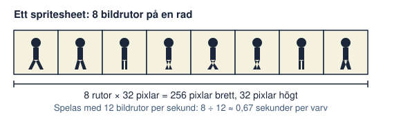

# Kapitel 6: Bild och animation i 2D

> **I det här kapitlet lär du dig**
> - hur form, färg och komposition styr vad spelaren ser
> - hur du väljer en visuell stil du faktiskt hinner genomföra
> - hur sprites, spritesheets och tiles fungerar
> - grunderna i animation och hur du räknar på bildrutor

Du har ett par sekunder på dig. När någon ser ditt spel för första gången ska personen direkt förstå vilken figur som styrs, vad som är farligt och vart det är tänkt att gå. Det har väldigt lite med hur "snyggt" du kan rita att göra. Det handlar om hur tydligt bilden berättar.

## Form

Börja med **silhuetten**, figurens yttre form utan detaljer. Färga figuren helt svart: går den fortfarande att känna igen? Om två figurer har samma silhuett blir de svåra att skilja åt i spel, särskilt när det går fort.

Formen säger också något om karaktären.

| Form | Brukar uppfattas som | Användning i spel |
|---|---|---|
| Runda former | Vänligt, mjukt | Spelfigurer, samlarföremål |
| Kantiga, spetsiga | Hotfullt, farligt | Fiender, hinder |
| Fyrkantiga | Stabilt, tungt | Väggar, stora figurer |

Det här är tumregler, inte naturlagar, men de fungerar eftersom vi människor tolkar former automatiskt.

## Färg

En färg kan beskrivas med tre egenskaper:

- **Nyans:** själva färgen, till exempel rött eller blått.
- **Mättnad:** hur stark eller grå färgen är.
- **Valör:** hur ljus eller mörk färgen är.

Valören är det viktigaste i spelgrafik, eftersom det är den som skapar kontrast. **Kisa med ögonen** mot din skärm, eller gör en kopia av bilden i gråskala. Syns fortfarande spelaren mot bakgrunden? Om inte är valörerna för lika.

En **palett** är den begränsade uppsättning färger du väljer att använda. Att välja få färger gör att allt känns som samma värld och dessutom går det snabbare att rita. Prova med fyra till åtta färger. Ge varje färg en uppgift:

| Färg i Fyrvaktaren | Uppgift |
|---|---|
| Djupt mörkblått | Natt, himmel, bakgrund |
| Grågrön | Mark och klippor, låg kontrast |
| Ljust gult | Allt som lyser och är viktigt |
| Rödorange | Fara, lampa nära att slockna |

Färgen gult används alltså bara på det spelaren ska lägga märke till. Det är en enkel regel som gör spelet lättare att läsa. Tänk samtidigt på att färg aldrig ska vara det enda sättet att visa något, eftersom inte alla ser färg på samma sätt. Kapitel 8 tar upp det.

## Komposition

**Komposition** är hur saker är placerade i bilden. I ett spel leder kompositionen spelarens blick. Ett par enkla grepp:

- Spelaren bör ha tydlig **kontrast** mot allt annat.
- **Förgrund, mellangrund, bakgrund:** bakgrunden är dämpad och har låg kontrast, mitten är där spelet utspelar sig.
- Linjer och ljusa punkter pekar vart spelaren ska. En rad lampor längs stranden drar blicken dit.

Komposition och tydlighet väger ofta tyngre än detaljer.

## Stil: välj en du hinner med

En konsekvent stil är bättre än en ambitiös stil som bara blev klar till hälften. Tre vanliga stilar för skolspel:

| Stil | Passar när | Att tänka på |
|---|---|---|
| Pixelgrafik | Du gillar små detaljer och begränsade paletter | Blanda inte olika pixelstorlekar |
| Vektor eller platta former | Du vill ha rena former | Varje form ska vara genomtänkt |
| Handritat | Du gillar att rita på papper | Skanna eller fotografera med jämnt ljus |

Att blanda stilar, till exempel lånad realistisk bakgrund och egenritad figur, gör att det ser ut som två spel. Har du lånade assets ska du välja dem från samma källa eller redigera dem så att de stämmer.

## Sprites, spritesheets och tiles

En **sprite** är en 2D-bild som används i ett spel, till exempel en figur eller ett mynt. Ett **spritesheet** är en enda bild som innehåller flera bildrutor i ett rutnät. En **tile** är en liten rutformad bit, till exempel 16 × 16 pixlar, som återanvänds för att bygga banor. I Godot bygger du banor av tiles med noden `TileMapLayer`.



### Genomräknat exempel: upplösning och tiles

Du vill använda pixelgrafik. En vanlig metod är att göra spelet i en låg **basupplösning** och förstora det till skärmen.

Vi väljer basupplösningen 320 × 180 och tiles på 16 × 16 pixlar.

```text
Bredd i tiles: 320 ÷ 16 = 20 tiles
Höjd i tiles:  180 ÷ 16 = 11,25 tiles
```

Skärmen får alltså plats med 20 tiles i bredd och drygt 11 på höjden. Den sista raden hamnar delvis utanför skärmen. Det är okej, men du måste tänka på det när du ritar dina banor.

För att visa spelet på en skärm med upplösningen 1920 × 1080:

```text
1920 ÷ 320 = 6
1080 ÷ 180 = 6
```

Allt förstoras exakt sex gånger. Eftersom skalan är ett heltal blir varje pixel lika stor. Under Project Settings, avsnittet Display → Window, ställer du **Stretch Mode** på `viewport` och **Scale Mode** på `integer`, så skalas spelet i hela steg. Under Rendering → Textures → Canvas Textures ställer du **Default Texture Filter** på `Nearest`, så att pixlarna förblir skarpa i stället för suddiga.

## Animation

**Animation** är en följd av bilder som visas så snabbt att ögat uppfattar rörelse. Varje bild kallas **bildruta**, och hastigheten mäts i bildrutor per sekund, **fps**.

### Genomräknat exempel: hur lång är en gångcykel?

En gångcykel har 8 bildrutor och spelas med 12 fps.

```text
Tid = antal bildrutor ÷ fps
Tid = 8 ÷ 12 ≈ 0,67 sekunder
```

Hela steget tar alltså två tredjedelar av en sekund. Känns det för långsamt? Höj till 16 fps och tiden blir 0,5 sekunder.

Om varje ruta är 32 × 32 pixlar och du lägger alla åtta på en rad blir spritesheetet:

```text
8 × 32 = 256 pixlar brett och 32 pixlar högt
```

Du behöver inte många rutor. En stillastående figur kan andas med bara två till fyra rutor. Gång behöver ofta fyra till åtta.

### Principer för rörelse

Disneys animatörer Frank Thomas och Ollie Johnston samlade tolv principer för animation i boken *The Illusion of Life*. Några är särskilt användbara i spel:

- **Timing:** hur lång tid en rörelse tar säger hur tung eller lätt något känns.
- **Squash and stretch:** något som landar trycks ihop, något som hoppar sträcks ut. Det ger tyngd.
- **Anticipation:** en liten rörelse åt motsatt håll innan själva handlingen, som att böja knäna före ett hopp.
- **Follow-through:** delar som rör sig vidare efter att kroppen stannat, till exempel en halsduk.

I spel får du dock inte låta anticipation fördröja kontrollen för mycket, för spelaren vill reagera direkt.

I Godot kan du använda noden `AnimatedSprite2D` för bildrutor och välja animation efter vad som händer. Det här är den enda kod kapitlet behöver:

```gdscript
extends CharacterBody2D

@onready var sprite: AnimatedSprite2D = $AnimatedSprite2D

func _physics_process(_delta):
    if velocity.length() > 0.0:
        sprite.play("ga")
    else:
        sprite.play("sta")
```

Animationerna `ga` och `sta` skapar du i animationspanelen. Du kan också använda noden `AnimationPlayer` för att animera vilka egenskaper som helst, till exempel att lampans ljus flimrar.

## Begrepp

- **Silhuett:** den yttre konturen av en figur.
- **Nyans, mättnad, valör:** färg, färgstyrka och ljushet.
- **Palett:** den begränsade samling färger ett verk använder.
- **Komposition:** hur saker är placerade i bilden.
- **Sprite:** 2D-bild som används i ett spel.
- **Spritesheet:** en bild med flera bildrutor.
- **Tile:** liten upprepad bit av en bana.
- **Bildruta och fps:** en enskild bild i en animation, och antal sådana per sekund.

## Testa dig själv

1. Hur kan du testa om en figur har en tydlig silhuett?
2. Varför är valör ofta viktigare än nyans i spelgrafik?
3. Vad händer med ett spel när palettens färger får tydliga uppgifter?
4. Vad är skillnaden mellan en sprite och ett spritesheet?
5. Varför bör en pixelgrafik skalas med ett heltal?
6. Vad är anticipation, och vilken risk finns med det i spel?

## Koppling till projektet

I [2D-spelet](../projekt/2d-spel/README.md) ska du ha sprites för spelare, fiender och bakgrund, minst en enkel animation och gärna ett tileset. Bestäm stil och palett innan du börjar rita, och skriv motiveringen i loggen.

## Läs mer

- [Godot: 2D-sprite-animation](https://docs.godotengine.org/en/stable/tutorials/2d/2d_sprite_animation.html)
- [Godot: tilemaps](https://docs.godotengine.org/en/stable/tutorials/2d/using_tilemaps.html)
- [Godot: flera upplösningar](https://docs.godotengine.org/en/stable/tutorials/rendering/multiple_resolutions.html)

[← Föregående](05-assets-och-upphovsratt.md) | [Innehåll](../README.md) | [Nästa →](07-ljud-och-musik.md)
