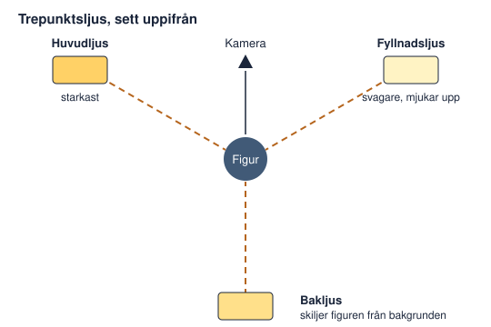
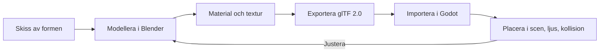

# Kapitel 9: Att gestalta i 3D

> **I det här kapitlet lär du dig**
> - vad som skiljer 3D från 2D, både tekniskt och estetiskt
> - hur modeller, material och ljus skapar stämning
> - hur kameran och miljön leder spelaren
> - hur du flyttar en modell från Blender till Godot

När du går från 2D till 3D får du en dimension till, och därmed helt nya frågor att besvara. Vilket håll tittar spelaren åt? Var kommer ljuset ifrån? Vad händer om spelaren går bakom huset? Den goda nyheten är att allt du redan vet om form, färg, ljud och berättande fortfarande gäller.

## Skillnaden mot 2D

I 2D bestämmer du exakt vad spelaren ser, bildruta för bildruta. I 3D skapar du en värld och placerar en kamera i den, och sedan räknar datorn ut bilden. Det är en förändring av hela ditt arbetssätt: du målar inte bilden, du **gestaltar en plats**. Att gestalta betyder att ge en idé konkret form, så att den kan upplevas.

| | 2D | 3D |
|---|---|---|
| Grundmaterial | Bilder | Modeller, material, ljus |
| Så uppstår bilden | Du ritar den | Datorn räknar ut den, kallat rendering |
| Vad spelaren ser | Det du valde | Beror på kamera och position |
| Vanligaste problem | Otydliga figurer | Spelaren vet inte vart den ska |

Tänk också på att scenen måste fungera från alla vinklar spelaren kan se den, men du behöver inte göra fint där spelaren aldrig kommer. Det är samma tänkande som i teater och film: bygg bara det som syns.

## Modeller och polygoner

En **3D-modell** består av ett nät (mesh) av punkter, **hörn**, som binds ihop till ytor, oftast trianglar. Fler trianglar ger mer detaljer men mer arbete för datorn.

Många spel använder medvetet en **lågpolygonstil** med få trianglar och tydliga plana ytor. Det är ett exempel på gränslandet mellan konst och teknik från kapitel 1: tekniskt enkelt, estetiskt ett eget uttryck. Det passar dessutom den tid du har.

Du har flera vägar till modeller:

| Väg | Arbetssätt | Passar när |
|---|---|---|
| Grundformer | Lådor och klot, färdiga i Godot | Prototyper och enkel stil |
| Blender | Modellera själv | Du vill ha en egen form |
| Assets | Hämta från till exempel Kenney | Tiden är knapp, läs licensen |

I Godot är **CSG-noder**, till exempel `CSGBox3D`, bra för att snabbt bygga en bana av enkla former. Det är 3D-världens svar på en pappersprototyp.

### Genomräknat exempel: trianglar och texturer

Vi uppskattar hur mycket Fyrvaktarens ö kräver:

| Objekt | Antal | Trianglar per styck | Summa |
|---|---:|---:|---:|
| Träd | 40 | 300 | 12 000 |
| Fyr | 1 | 5 000 | 5 000 |
| Lampa | 6 | 800 | 4 800 |
| **Totalt** | | | **21 800** |

Du behöver inte ha en exakt gräns, men att räkna visar vad som kostar mest. Här står träden för mer än hälften. Sänker du dem till 150 trianglar sparar du 6 000.

Texturer tar också plats i grafikminnet. En textur med sidan 1024 pixlar och 4 byte per pixel tar:

```text
1024 × 1024 × 4 = 4 194 304 byte = 4 MiB
```

Dessutom sparar grafikkortet ofta mindre versioner av texturen, så kallade **mipmaps**, som tar upp ungefär en tredjedel till. Det blir totalt cirka 5,3 MiB. Texturkomprimering minskar siffrorna, men principen gäller: stora texturer på små objekt är slöseri.

## Material och texturer

Ett **material** beskriver hur en yta reagerar på ljus. En **textur** är en bild som läggs på ytan. I Godot används ofta `StandardMaterial3D`, med några viktiga egenskaper:

| Egenskap | Styr | Exempel |
|---|---|---|
| Albedo | Grundfärgen | Vit puts på fyren |
| Roughness | Hur matt eller blank | Vått berg är blankare |
| Metallic | Hur metallisk | Mässing på lampan |
| Emission | Lyser av sig själv | Lågan i lyktan |

Med bara tre material i en dämpad färgskala kan spelet ändå se genomtänkt ut. Som i 2D blir resultatet bättre av en palett.

## Ljus

Ljuset är kanske det viktigaste konstnärliga verktyget i 3D. Samma ö kan vara idyllisk eller skrämmande beroende på ljuset. Godot har tre huvudtyper av ljuskällor:

| Nod | Fungerar som | Exempel |
|---|---|---|
| `DirectionalLight3D` | Sol eller måne, parallella strålar | Svagt månsken |
| `OmniLight3D` | Glödlampa, lyser åt alla håll | Lampans låga |
| `SpotLight3D` | Strålkastare, kon | Fyrens ljuskägla |

Med noden `WorldEnvironment` styr du himmel, dimma och färgton i hela scenen. **Dimma** ger känsla av djup och avstånd och döljer samtidigt det som ligger långt bort.

En klassisk metod från film är **trepunktsljus**: ett starkt huvudljus från sidan, ett svagare fyllnadsljus från motsatt sida och ett bakljus som skiljer figuren från bakgrunden.



Skuggor ger tyngd men kostar datorkraft. Låt bara de ljus som verkligen behöver det kasta skuggor.

Tänk på att mörker och tillgänglighet kan krocka. Ett mörkt spel måste ändå gå att se, så testa på en sämre skärm och överväg ett val för ljusstyrka.

## Kamera och riktning

I 3D är kameran också ett berättarverktyg.

- **Första person** ger närhet, men spelaren ser inte sin figur.
- **Tredje person** visar figuren, men kameran kan fastna i väggar. Noden `SpringArm3D` hjälper till med det.
- **Från ovan** ger överblick och fungerar bra för Fyrvaktaren, där du behöver se flera lampor.

Spelaren behöver veta vart den ska. Det kallas **vägvisning**, och görs bäst med miljön:

- Ett högt **landmärke**, som fyren, syns överallt och ger riktning.
- **Ljus** drar blicken. Det ljusaste stället ser viktigast ut.
- **Stigar** och linjer leder i en riktning.
- **Öppningar och färg** kan markera att något är möjligt.

Tänk på skalan också. I Godot motsvarar en enhet en meter, och fysiken är inställd efter det. En vuxen människa är ungefär 1,7 till 1,8 enheter hög och en dörr ungefär 2 enheter. Använder du sådana mått känns världen rätt, och figurens hopp och fall beter sig som spelaren väntar sig.

## Från Blender till Godot

Ett typiskt 3D-arbetsflöde ser ut så här:



Godots dokumentation rekommenderar formatet glTF 2.0, som finns i varianterna `.gltf` och `.glb`. Spara också Blender-filen, det är din källfil. Filer i projektmappen uppdateras automatiskt när du exporterar om dem.

## Begrepp

- **Rendering:** när datorn räknar ut en bild utifrån en 3D-scen.
- **Mesh:** nätet av hörn och ytor som bildar en modell.
- **Lågpolygonstil:** stil med få trianglar och plana ytor.
- **Material:** beskriver hur en yta reagerar på ljus.
- **Textur:** bild som läggs på en yta.
- **Trepunktsljus:** belysning med huvudljus, fyllnadsljus och bakljus.
- **Vägvisning:** hur miljön leder spelaren.
- **Landmärke:** något högt eller tydligt som ger riktning.

## Testa dig själv

1. På vilket sätt förändras ditt arbete när du går från 2D till 3D?
2. Vad är skillnaden mellan ett material och en textur?
3. Varför kan lågpolygonstil vara ett bra val?
4. Vilken ljuskälla skulle du använda för en lykta, och varför?
5. Hur kan ljus användas för att visa spelaren vägen?
6. Vilka är trepunktsljusets tre delar, och vilken uppgift har var och en?
7. Varför är det smart att modellera i rätt skala?

## Övningar

**Grund.** Bygg ett rum i Godot med enbart CSG-former och ge det tre olika stämningar genom att bara ändra ljuset. Ta en skärmbild av var och en.

**Grund.** En textur är 2048 × 2048 pixlar med 4 byte per pixel. Hur mycket minne tar den utan mipmaps och komprimering?

<details><summary>Svar</summary>

2048 × 2048 × 4 = 16 777 216 byte, vilket är 16 MiB.

</details>

**Vidare.** En scen innehåller 25 stenar med 500 trianglar och 10 buskar med 150 trianglar. Hur många trianglar är det totalt?

<details><summary>Svar</summary>

25 × 500 + 10 × 150 = 12 500 + 1 500 = 14 000 trianglar.

</details>

**Vidare.** Bygg en liten plats där spelaren ska hitta ett mål utan att någon text säger vart. Testa med en kamrat och se om det fungerar.

**Utmaning.** Välj en scen från ett 3D-spel du gillar. Analysera hur ljus, färg och kamera styr vad du lägger märke till och vilken känsla scenen ger.

## Koppling till projektet

[3D-spelet](../projekt/3d-spel/README.md) kräver en spelbar 3D-miljö med modeller, material eller texturer, kamera som följer spelaren och tydlig navigering. Börja med en grå prototyp, bestäm stämningen med ljus och dimma, och lägg in detaljer sist.

## Läs mer

- [Godot: introduktion till 3D](https://docs.godotengine.org/en/stable/tutorials/3d/introduction_to_3d.html)
- [Godot: material](https://docs.godotengine.org/en/stable/tutorials/3d/standard_material_3d.html)
- [Godot: ljus och skuggor](https://docs.godotengine.org/en/stable/tutorials/3d/lights_and_shadows.html)
- [Godot: miljö och efterbehandling](https://docs.godotengine.org/en/stable/tutorials/3d/environment_and_post_processing.html)
- [Godot: tillgängliga 3D-format](https://docs.godotengine.org/en/stable/tutorials/assets_pipeline/importing_3d_scenes/available_formats.html)

[← Föregående](08-granssnitt-och-upplevelse.md) | [Innehåll](../README.md) | [Nästa →](10-testa-analysera-visa.md)
